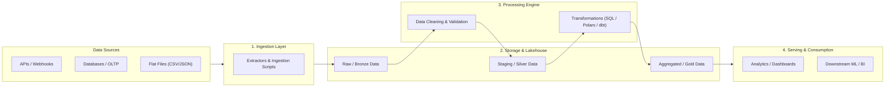

# DE_Project_2026

[](https://www.python.org/)
[](https://github.com/psf/black)
[](LICENSE)
[]()

> **Data Engineering Project 2026** — An end-to-end modern data engineering repository designed for robust data ingestion, transformation, storage, and orchestration.

---

## 📖 Table of Contents

- [Overview](#-overview)
- [Architecture Blueprint](#-architecture-blueprint)
- [Repository Structure](#-repository-structure)
- [Tech Stack](#-tech-stack)
- [Getting Started](#-getting-started)
  - [Prerequisites](#prerequisites)
  - [Installation & Setup](#installation--setup)
  - [Environment Configuration](#environment-configuration)
- [Usage](#-usage)
- [Testing & Quality Assurance](#-testing--quality-assurance)
- [Roadmap & Planned Phases](#-roadmap--planned-phases)
- [Contributing & License](#-contributing--license)

---

## 🔭 Overview

`DE_Project_2026` provides a modular, production-ready foundation for building modern data pipelines. The repository is organized according to industry best practices, separating concerns between ingestion, data transformation/cleaning, pipeline orchestration, and analytical storage.

### Key Objectives
- **Scalable Data Ingestion**: Batch and stream ingestion from diverse source systems (APIs, files, databases).
- **Reliable Data Transformations**: Standardized transformation layers (Bronze/Raw $\rightarrow$ Silver/Staging $\rightarrow$ Gold/Warehouse).
- **Reproducible Environments**: Containerized execution and declarative dependency management.
- **Data Quality & Observability**: Automated schema validation, data testing, and structured logging.

---

## 🏗 Architecture Blueprint



---

## 📁 Repository Structure

```text
DE_Project_2026/
├── .github/                  # GitHub Actions CI/CD workflows
├── config/                   # Configuration files (YAML, JSON, settings)
│   └── config.yaml
├── data/                     # Local data storage (gitignored except .gitkeep)
│   ├── raw/                  # Immutable source data (Bronze layer)
│   ├── staging/              # Cleaned & normalized intermediate data (Silver layer)
│   └── warehouse/            # Curated analytical models / parquet (Gold layer)
├── docker/                   # Dockerfile and container configuration
├── notebooks/                # Jupyter / exploratory analysis notebooks
├── src/                      # Core application source code
│   ├── __init__.py
│   ├── ingestion/            # Source extractors and loaders
│   ├── transformation/       # Data cleaning, normalization, enrichment
│   ├── pipeline/             # Pipeline runners & orchestrators
│   └── utils/                # Shared utilities (logging, db connectors, config)
├── tests/                    # Unit, integration, and data validation tests
├── .env.example              # Example environment variable template
├── .gitignore                # Git ignore rules for data, envs, caches
├── pyproject.toml            # Project packaging & tool configuration
├── requirements.txt          # Python runtime dependencies
├── requirements-dev.txt      # Development & testing dependencies
└── README.md                 # Project documentation
```

---

## 🛠 Tech Stack

- **Language**: Python 3.11+
- **Data Manipulation & Processing**: Polars / Pandas / PyArrow / DuckDB
- **Data Validation**: Pydantic / Great Expectations
- **Testing & Tooling**: Pytest, Ruff, Black, Pre-commit
- **Orchestration / Infrastructure**: Docker, Docker Compose, Make (Airflow / Mage / Prefect ready)

---

## 🚀 Getting Started

### Prerequisites

- **Python**: version 3.11 or higher
- **Git**
- **Docker** *(optional, for containerized services)*

### Installation & Setup

1. **Clone the repository**:
   ```bash
   git clone https://github.com/WhiteShadow005/DE_Project_2026.git
   cd DE_Project_2026
   ```

2. **Create and activate a virtual environment**:
   ```bash
   python3 -m venv .venv
   source .venv/bin/activate    # On Windows: .venv\Scripts\activate
   ```

3. **Install dependencies**:
   ```bash
   pip install --upgrade pip
   pip install -r requirements.txt
   pip install -r requirements-dev.txt   # Optional: For development and testing
   ```

### Environment Configuration

Create a local `.env` file from the provided template:

```bash
cp .env.example .env
```

Edit `.env` to configure your local credentials, database URLs, and API endpoints.

---

## ⚡ Usage

Run the starter pipeline entry point:

```bash
python -m src.main
```

Or execute specific pipeline modules:

```bash
# Run ingestion
python -m src.ingestion.sample_extractor

# Run transformation
python -m src.transformation.sample_transformer
```

---

## 🧪 Testing & Quality Assurance

Run the test suite with `pytest`:

```bash
pytest tests/ -v
```

Format and lint code:

```bash
ruff check .
ruff format .
```

---

## 🗺 Roadmap & Planned Phases

- [x] Initial repository scaffolding and directory structure
- [x] Base configuration and environment setup
- [ ] Implement data ingestion connectors
- [ ] Build transformation & data validation pipelines
- [ ] Set up data storage / lakehouse layer
- [ ] Add CI/CD automated test workflow
- [ ] Implement end-to-end orchestration

---

## 📄 License & Author

- **Author**: Arnav Gupta ([@WhiteShadow005](https://github.com/WhiteShadow005))
- **License**: MIT
